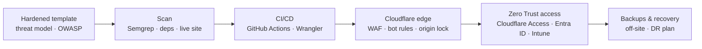

### Hi, I'm Marios 👋

IT Systems Administrator II in Larnaca, Cyprus, focused on DevSecOps. I build the internal apps my company runs on with AI, then do the part AI won't do for you: secure them, ship them through CI/CD and keep them running on Cloudflare.

**Portfolio:** [mxenofontos.com](https://mxenofontos.com) · **LinkedIn:** [marios-xenofontos](https://www.linkedin.com/in/marios-xenofontos/) · **CV:** [PDF](https://mxenofontos.com/Marios-Xenofontos-CV.pdf)

> My work repositories are private because they belong to the companies I build for. This page describes what they do and how they're built and secured. Happy to talk through any of it.

---

#### What I've built and run in production

| App | What it does | Status |
|---|---|---|
| **Company AI assistant** | Central AI chat that reaches company databases through MCP, with RBAC on every data source, limits on what the AI can read, and GDPR and EU AI governance built in | 🟡 building |
| **IT environment & asset hub** | Every system and piece of software we use, what it does, where its data lives and who owns it. Live data from the GitHub and Cloudflare APIs. Replaced most of Snipe-IT | 🟢 live |
| **Workforce scheduling** | Company-wide shift planning with roles, automatic overtime and payroll exports | 🟢 live |
| **Appraisal system** | One performance review process for the whole company | 🟢 live |
| **Department operations apps** | KPI and case tracking, one app per department | 🟢 live |
| **Social media calendar** | One content calendar across all company social accounts | 🟢 live |
| **Security baseline for AI-built apps** | Secure Workers template, threat model, OWASP rules, SAST, dependency and live-site scanning | 🟢 in use |

#### How every app ships

#### What I work with

**Cloudflare:** Workers, Pages, D1, KV, R2, Durable Objects, Queues, Workflows, Workers AI, Vectorize, Hyperdrive, Email, Analytics Engine, Secrets Store, Access / Zero Trust, WAF, Turnstile, rate limiting, mTLS 
**GitHub & CI/CD:** Actions (reusable and scheduled workflows, staging/production environments), Wrangler, Dependabot, CODEOWNERS, Gitleaks, actionlint, Semgrep 
**Logging & checks:** Workers Logs, Logpush, audit and security event logs, Analytics Engine, health checks after deploy, uptime monitors, alerts, CSP and HSTS 
**Development:** TypeScript, Node.js, Hono, React, Next.js, Vite, Tailwind, Zod, Drizzle, Prisma, Vitest, Playwright, MCP, AI-assisted development 
**Microsoft & identity:** Microsoft 365, Entra ID, Intune, Conditional Access, passkey MFA 
**Infrastructure:** Ubuntu, Windows Server, Docker, Nginx, Ansible, VMware, Proxmox, Veeam, UniFi, Zabbix, Grafana

📍 Larnaca, Cyprus · ✉️ mariosxen7@icloud.com
