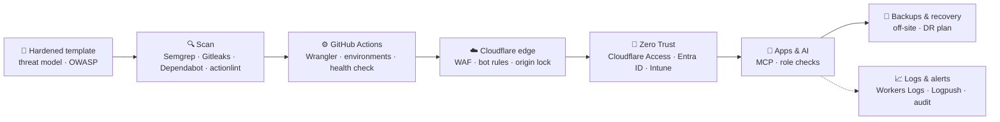

  

  
  
  

  
  
  
  
  
  
  

---

### 👋 Hi, I'm Marios

IT Systems Administrator II in **Larnaca, Cyprus**, focused on **DevSecOps**. I build web apps with AI, then do the part AI won't do for you: **secure them, ship them through CI/CD and keep them running on Cloudflare**.

- 🛡️ Every app passes the same security baseline before it ships
- 🔐 Logins sit behind **Cloudflare Zero Trust**; data reads go through **MCP with role checks**
- 📈 Logs, audit trails, health checks and alerts on everything in production
- 💾 Off-site backups and a written recovery plan per app
- 🤖 I build with AI and Cloudflare every day, so I keep up with both as they change

> My repositories are private. This page shows what the projects do and how they're built and secured. Happy to talk through any of it.

---

### 🧰 Stack

   
   
  

---

### 🚀 What I've built

| | Project | What it does | Status |
|:-:|---|---|:-:|
| 🤖 | **Internal AI assistant** | AI chat that answers from an organisation's databases through **MCP**, with RBAC on every source, limits on what the AI can read, and GDPR & EU AI governance built in |  |
| 🗂️ | **IT environment & asset hub** | Every system and piece of software, what it does, where its data lives and who owns it. Live data from the GitHub & Cloudflare APIs, per-person hardware, joiners and leavers |  |
| 📅 | **Workforce scheduling** | Organisation-wide shift planning with roles, automatic overtime and payroll exports |  |
| ⭐ | **Appraisal system** | One performance review process for everyone, history in one place |  |
| 📊 | **Department operations apps** | KPI and case tracking, one app per department |  |
| 🗓️ | **Social media calendar** | One content calendar across all social accounts |  |
| 🛡️ | **Security baseline for AI-built apps** | Hardened Workers template, threat model, OWASP rules, SAST, secret, dependency and live-site scanning |  |

---

### 🔄 How every app ships

---

### 🧩 Details

<b>☁️ Cloudflare</b>

 

Workers · Pages & static assets · D1 · KV · R2 · Durable Objects · Queues · Workflows · Workers AI · Vectorize · Hyperdrive · Email · Analytics Engine · Secrets Store · Access / Zero Trust · WAF · Turnstile · rate limiting · mTLS · Images · Workers for Platforms · cron triggers · service bindings · staging & production environments

<b>⚙️ GitHub & CI/CD</b>

 

GitHub Actions (reusable and scheduled workflows, environments and production gates) · Wrangler · Dependabot · CODEOWNERS · Gitleaks secret scanning · actionlint workflow checks · Semgrep SAST · dependency audits · D1 migrations in CI · post-deploy health checks

<b>📈 Logging & checks</b>

 

Workers Logs · Logpush · audit and security event logs · Analytics Engine · Web Analytics · health endpoints · uptime monitors · alerts · CSP · HSTS · security.txt

<b>🔐 Auth & identity</b>

 

Better Auth (open source, self-hosted on D1: email one-time codes, rate limits, secure sessions) · Microsoft 365 · Entra ID · Intune · Conditional Access · passkey MFA

<b>🛠️ Development</b>

 

TypeScript · Node.js · Hono · React · Next.js (OpenNext) · Vite · Tailwind CSS · Zod · Drizzle · Prisma · PostgreSQL · Vitest (Workers pool) · Playwright · ESLint · Biome · Vercel AI SDK · MCP

<b>🖥️ Infrastructure & network</b>

 

Ubuntu Server · Windows Server & Active Directory · Docker · Nginx · Ansible · VMware vSphere · Proxmox · Hyper-V · Veeam · Synology · TrueNAS · Ubiquiti UniFi · Cisco Meraki · VLANs · WireGuard · IPsec · Zabbix · Grafana · Uptime Kuma · PowerShell · Bash

---

  📍 Larnaca, Cyprus · 🇬🇷 Greek · 🇬🇧 English · <a href="https://mxenofontos.com">mxenofontos.com</a>

